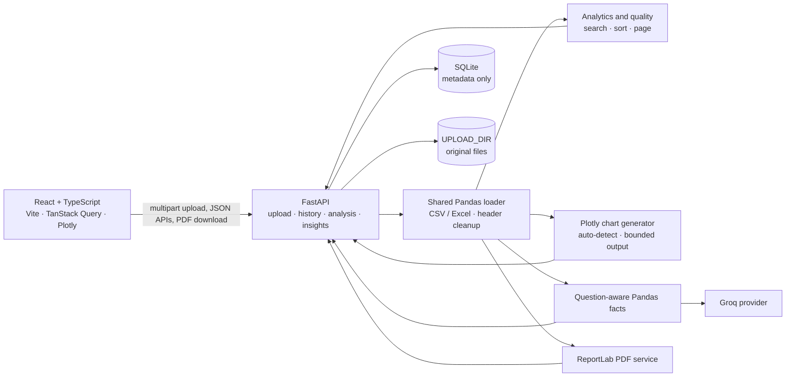

# DataPilot system design

## Scope and current architecture

DataPilot is a single-instance web application. React requests data from FastAPI; Pandas reads each uploaded source file for preview and analytics; Plotly builds chart specifications; ReportLab creates a PDF; and the configured Groq provider writes optional AI explanations.

The Analytics page requests summary and chart data for the selected dataset ID. It retains a bounded table preview, search, sorting, pagination, existing profiling cards, and responsive chart cards. Charts are not a separate navigation destination. AI Chat and the AI-written Reports page call the one-shot insights endpoint; chat turns are not stored on the backend.

## Upload and persistence flow

1. `POST /api/upload` accepts a CSV, XLSX, or XLS file. The route validates the extension and configured byte limit (`MAX_UPLOAD_MB`), then writes the source under `UPLOAD_DIR` with a generated UUID filename.
2. The shared loader parses the file before metadata registration. It normalizes blank/`Unnamed` and duplicate headers, preserves recognized identifier values and formatted Excel identifiers, and infers supported date types. A parse failure removes the newly written file and returns a client error.
3. The backend registers metadata in `DATA_DIR/datasets.sqlite3`: ID, original filename, UTC upload time, extension, row and column counts, byte size, absolute storage path, and status.
4. `GET /api/datasets` reads persisted records from SQLite. It calculates whether each recorded path still exists and reports `ready` or `missing`. Dataset endpoints return not-found when either the ID or its source file is unavailable.
5. `DELETE /api/datasets/{id}` checks that the recorded file is directly inside the configured upload directory, deletes that file, and removes the metadata record.

SQLite is the metadata index, not the dataset store. Restart persistence requires the SQLite file and all referenced upload files to remain on durable storage at the same configured locations. Back them up and restore them together. Metadata registration is performed after successful parsing; this local implementation does not include distributed transactions, multi-instance coordination, or an orphan cleanup service.

## Preview and analytics flow

`GET /api/datasets/{id}/summary` reads the source file and computes profiling, data quality, duplicate rows, and summary statistics over the complete DataFrame. Preview rows are produced separately:

1. If a search string is supplied, convert values to strings and apply a case-insensitive literal substring match across all columns; null cells do not match.
2. If requested, sort the filtered full dataset using a stable sort.
3. Calculate the matching-row count and paginate the result.
4. Return only that page, together with total rows, matching rows, effective current page, page size, and dataset-wide statistics.

The page size is limited to 100 rows. Search is not restricted to the first preview page. The `DataTable` owns its bounded horizontal/vertical overflow; it does not render the entire dataset into the page DOM.

## Chart generation

`GET /api/datasets/{id}/charts` loads the same normalized DataFrame and detects numeric measurements, categories/booleans, and date/time columns. Identifier-like columns are excluded from measurement candidates. It generates only suitable types among bar, pie, histogram, time series, scatter, box, and correlation heatmap. Unsupported types return a reason; processing failures are returned as errors instead of being mislabeled as unsuitable data.

Automatic generation returns no more than six charts. Category counts, heatmap width, scatter and line point counts, and box plot point counts are bounded in the chart service. Plotly figure JSON is returned to React, which displays it in responsive cards with hover and zoom. PNG export uses Plotly's browser-side image export capability when available.

## AI insights and reports

`POST /api/datasets/{id}/insights` computes a bounded JSON context with Pandas before asking the configured provider to explain it. Facts include full-dataset row/column and missing/duplicate counts, selected question-relevant column statistics, common category shares, and requested grouped sums or correlations where suitable. Context is capped at 12,000 characters and avoids sending a raw table/sample of all records. The API returns the model narrative and a separate list of verified calculated facts.

Provider configuration and request failures are surfaced as service errors; exact calculations remain available in the response's `verified_facts` only when the provider request succeeds. `GROQ_API_KEY` is required only for AI. The configured provider and default model are not changed by this work.

`GET /api/datasets/{id}/report.pdf` builds a downloadable report with a dataset overview, per-column statistics, data-quality findings, and up to two bounded, data-derived vector summaries. It is independent of Groq. The Reports page's AI narrative is a separate Markdown export; the deterministic PDF download is on the dataset Analytics page.

## API surface

| Method | Path | Function |
|---|---|---|
| `GET` | `/health` | Basic liveness response |
| `POST` | `/api/upload` | Validate, parse, persist a CSV/Excel file |
| `GET` | `/api/datasets` | List persisted dataset metadata |
| `DELETE` | `/api/datasets/{id}` | Delete the stored source and metadata |
| `GET` | `/api/datasets/{id}/summary` | Dataset analytics plus searchable, sortable, paginated rows |
| `GET` | `/api/datasets/{id}/charts` | Automatic or selected Plotly chart specifications |
| `POST` | `/api/datasets/{id}/insights` | Groq narrative plus independently computed facts |
| `GET` | `/api/datasets/{id}/report.pdf` | Deterministic PDF download |

The app also serves `/` and `/docs`. `CORS_ORIGINS` configures browser origins. See the root README for local setup and variables.

## Reliability, security, and known constraints

- No authentication, authorization, user isolation, or rate limiting is implemented. The service is not safe to expose as a public multi-tenant API.
- Upload content is copied from FastAPI's spooled multipart file to storage in 1 MiB chunks. The configured default limit is 100 MiB; concurrent uploads can still multiply temporary-disk and parsing memory pressure.
- CSV/Excel parsing and Pandas analytics run within the API process. Large or adversarial workbooks can consume significant CPU and memory.
- SQLite is local metadata storage with a single-instance operating assumption. Multiple API instances do not share a consistent local filesystem/database unless an external shared volume is configured; SQLite is not the intended multi-writer deployment database.
- `UPLOAD_DIR` and `DATA_DIR` are local paths. There is no automatic retention, backup, or orphan cleanup policy.
- Health is liveness only. It does not check SQLite, storage availability, or Groq.
- Model output is explanatory text, not an authoritative calculation. Use the separately returned Pandas facts for exact values.

## Future design for 1,000 simultaneous uploads (not current capacity)

The present application has not been load-tested or designed to guarantee 1,000 concurrent uploads. A scale-out design would separate transfer, metadata, and parsing rather than increasing the current process count alone:

1. **Frontend and edge:** Keep the React client, place a TLS-terminating load balancer/API gateway in front of stateless FastAPI replicas, enforce authenticated user/tenant quotas, request limits, rate limits, and upload concurrency limits.
2. **Direct durable transfer:** Replace full-request in-memory reads with multipart streaming to object storage (preferably client uploads via short-lived, scoped pre-signed URLs). Enforce size and content checks; do not trust client MIME types. Record checksums and idempotency keys.
3. **Metadata database:** Move metadata to managed PostgreSQL with explicit ownership, transactional lifecycle/status fields, indexes, migrations, and retention rules. Do not use a shared network SQLite file as a multi-replica coordination mechanism.
4. **Asynchronous processing:** After upload completion, enqueue a dataset ID and object key. A bounded worker pool validates and parses the object, calculates profiling, and writes compact results/artifacts. Expose `processing`, `ready`, and `failed` states and a status endpoint. Apply per-task time, memory, and decompression limits; prevent ZIP-bomb and oversized-workbook exhaustion.
5. **Analytics and charts:** Cache immutable, versioned profiles and chart specifications by dataset ID. Use worker isolation for expensive operations, enforce row/column/point limits, and make retries idempotent. Keep search against the full logical dataset through an explicitly chosen analytical store rather than returning all rows to the browser.
6. **Operations:** Add queue depth, upload throughput, processing latency/failure, memory, storage, database, and provider metrics; structured logs, tracing, alerts, backup/restore drills, retention/deletion propagation, and load tests with the target file-size distribution.

Before claiming a target of 1,000 simultaneous transfers, load-test the complete path with realistic file sizes, concurrency ramp-up, failure/retry cases, worker saturation, and durable-storage/database bottlenecks. Define whether “simultaneous” means uploads in progress or datasets actively parsing; these have different resource requirements.
